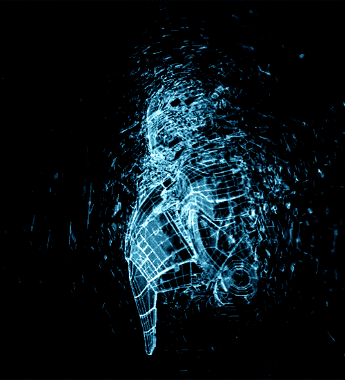

 

  

<h2 align="center">About Me</h2>

<table>
<tr>
<td width="62%" valign="top">

I am an engineer working at the intersection of **hardware and software**, with a B.Sc. in **Internet of Things and Robotics Engineering** from the University of Frontier Technology, Bangladesh.

My technical interests span **IoT, embedded systems, robotics, machine learning and AI engineering**, with a focus on developing intelligent, connected and practical engineering solutions. I enjoy bridging the gap between physical systems and software through system integration, automation and intelligent computing.

I am particularly interested in building projects that **combine embedded intelligence, real-world sensing, robotics and AI-driven applications** to solve meaningful technical challenges.

I am open to opportunities in **IoT, robotics, and software engineering, as well as research collaborations** in applied AI.

</td>
<td width="38%" align="center" valign="middle">

</td>
</tr>
</table>

<h2 align="center">Tech Stack</h2>

<table width="100%">
<tr>
<td width="50%" valign="top" align="center">

<h4>Languages</h4>

</td>
<td width="50%" valign="top" align="center">

<h4>Web and Backend</h4>

</td>
</tr>
<tr>
<td width="50%" valign="top" align="center">

<h4>AI and Data</h4>

 

</td>
<td width="50%" valign="top" align="center">

<h4>Databases and DevOps</h4>

</td>
</tr>
<tr>
<td width="50%" valign="top" align="center">

<h4>Mobile</h4>

 

</td>
<td width="50%" valign="top" align="center">

<h4>IoT and Embedded</h4>

 

</td>
</tr>
</table>

<h2 align="center">Featured Projects</h2>

<table width="100%">
<tr>
<td width="50%" valign="top">

<h3><a href="https://github.com/tamzid16?tab=repositories&q=DeviceMonitor">DeviceMonitor</a></h3>
<b>Native Android app for IoT devices and sensor readings</b>

Organizes IoT devices, records sensor readings, shows historical trends and manages threshold alerts. Compatible ESP32 devices can be read over an HTTP endpoint, and data is stored locally on the device.

</td>
<td width="50%" valign="top">

<h3><a href="https://github.com/tamzid16?tab=repositories&q=KnowledgeOS">KnowledgeOS</a></h3>
<b>AI knowledge workspace for grounded document search and RAG chat</b>

Turns PDF, DOCX, TXT and Markdown files into searchable collections. Combines pgvector retrieval, hybrid search, reranking, streaming chat with source citations and built-in RAG evaluation. Runs locally without a paid model API.

</td>
</tr>
<tr>
<td width="50%" valign="top">

<h3><a href="https://github.com/tamzid16?tab=repositories&q=Project+Management">Project Management System</a></h3>
<b>Full-stack project tracking application</b>

Manages projects, phases, tasks, activities and contacts with per-user dashboards and Chart.js visualizations. Credential login uses NextAuth.js. The repository also includes a separate Spring Boot REST API module.

</td>
<td width="50%" valign="top">

<h3><a href="https://github.com/tamzid16?tab=repositories&q=Fish">Fish Recommendations System</a></h3>
<b>Fish selection platform for communities, aquaculture and hobbyists</b>

Suggests fish by environment, size and sustainability, with a species database, sustainability tracking, market and weather data integration and user profiles. Secure login uses NextAuth.js with bcrypt.js hashing.

</td>
</tr>
</table>

<h3 align="center">Other Notable Projects</h3>

<table width="100%">
<tr>
<td width="33%" valign="top">

<b><a href="https://github.com/tamzid16?tab=repositories&q=RAGBench">RAGBench</a></b> 
RAG evaluation lab with controlled experiments, trace inspection and run comparison. 

</td>
<td width="33%" valign="top">

<b><a href="https://github.com/tamzid16?tab=repositories&q=RepoPilot">RepoPilot AI</a></b> 
Code-aware RAG with tree-sitter parsing and line-level source citations. 

</td>
<td width="33%" valign="top">

<b><a href="https://github.com/tamzid16?tab=repositories&q=AgentDesk">AgentDesk</a></b> 
Agent runtime with approval checkpoints and observability. 26 backend tests. 

</td>
</tr>
<tr>
<td width="33%" valign="top">

<b><a href="https://github.com/tamzid16?tab=repositories&q=DocIntel">DocIntel</a></b> 
Structured document extraction with validation and human review. 

</td>
<td width="33%" valign="top">

<b><a href="https://github.com/tamzid16/ExpenseIQ-App">ExpenseIQ</a></b> 
Offline-first personal finance tracker for Android. 

</td>
<td width="33%" valign="top">

<b><a href="https://github.com/tamzid16?tab=repositories&q=GHURI">GHURI Safe Travel Platform</a></b> 
Safe travel app with IoT tracking, bookings, guides and payments. 

</td>
</tr>
</table>

<h2 align="center">GitHub Activity</h2>

<h2 align="center">Connect With Me</h2>

Eager to contribute to IoT, robotics and software engineering projects while pursuing collaborative applied AI research

 

